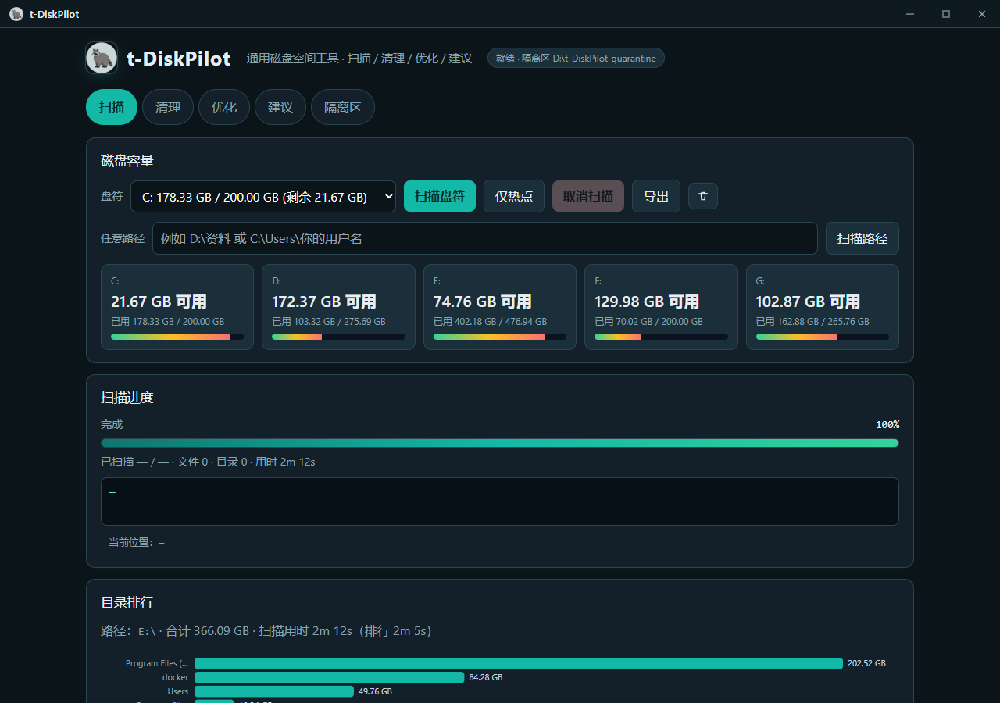
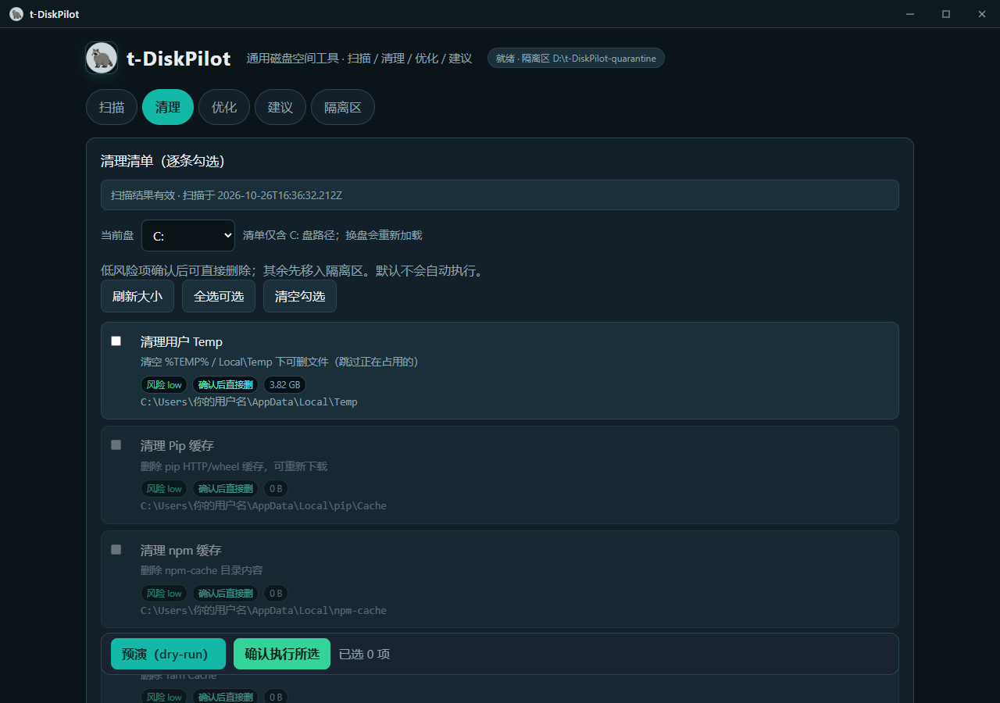
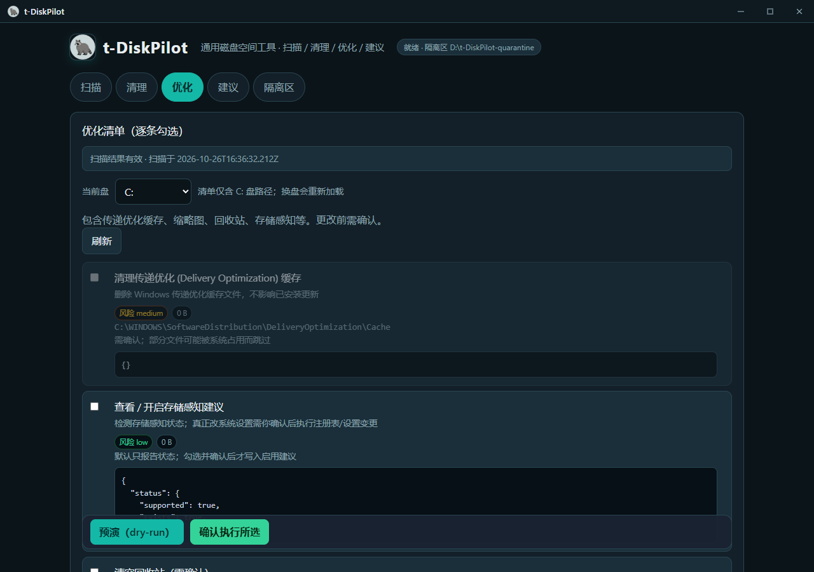
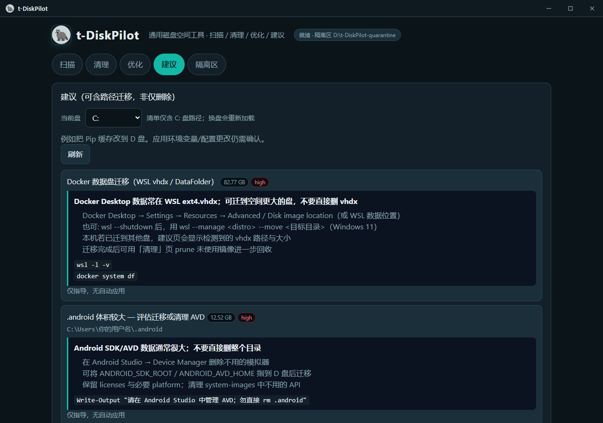

# t-DiskPilot

通用磁盘空间工具：扫描 / 清理 / 优化 / 建议。

**不会自动执行**破坏性或改配置操作；一律「生成计划 → 勾选 → 输入 CONFIRM → 执行 → 写日志」。

## 界面预览









## 技术栈

| 层 | 技术 |
|------|------|
| 前端 | React 18 + Vite 5 + Tailwind CSS + SCSS |
| 图表 | d3（目录排行条形图） |
| 后端 API | Node.js + Express（`server/`，端口默认 3789） |
| 桌面壳 | Tauri 2（`src-tauri/`） |

## 要求

- Windows（主要目标）
- Node.js ≥ 18
- 桌面壳另需：Rust（含可用的 **cargo**）、WebView2

## 安装与开发

```powershell
cd <repo-root>
npm install
npm run dev
```

也可用根目录 **`start.cmd`**：双击弹出命令行窗口，自动 `npm install`（若缺依赖）后执行 `npm run dev`；关闭窗口即停止服务。

- API：http://127.0.0.1:3789  
- UI（Vite）：http://127.0.0.1:5173 （`/api` 已代理到 3789）

只用后端（无 Vite）时：`npm run dev:server` 或 `npm start`。若已 `npm run build`，Express 会托管 `dist/`；否则回退到 `legacy-public/`（旧版 vanilla UI）。

### 生产构建（Web）

```powershell
npm run build
npm start
```

浏览器打开：http://127.0.0.1:3789

可用环境变量 `PORT` 改端口。

### 桌面壳（Tauri）

```powershell
# 需先修好 cargo（见下方「Cargo 阻塞」）
npm run tauri:dev
# 打包
npm run tauri:build
```

Tauri 开发时只启动 Vite UI；请另开终端跑 `npm run dev:server`，以便前端调 Express API。

#### Cargo 阻塞（本机现状）

若 `cargo --version` 报错类似：

```text
error: the 'cargo.exe' binary ... is not applicable to the 'stable-x86_64-pc-windows-msvc' toolchain
```

可尝试重装工具链后再跑 Tauri：

```powershell
rustup toolchain uninstall stable-x86_64-pc-windows-msvc
rustup toolchain install stable-x86_64-pc-windows-msvc
rustup default stable-x86_64-pc-windows-msvc
cargo --version
```

图标：把 PNG/ICO 放到 `src-tauri/icons/`（可从同目录 SquirrelDisk 的 icons 复制）。

## 特性

- **扫描结果持久化与缓存**：完成后写入 `data/last-scan.json`；再次打开扫描页会先展示「来自缓存 · 扫描时间」的排行与热点，无需重扫。
- **按目标盘过滤热点**：热点规则仅测量落在所选盘符上的路径；扫 G 盘时不会再跑 C 盘的 npm-cache 等规则。
- **点扫描即清缓存**：开始新扫描时清除 `last-scan.json` 与清理/优化/建议的内存缓存，界面同步清空旧排行与热点。
- **LoadingBlock 进度**：清理 / 优化 / 建议加载清单时显示进度块（`useLoadProgress`），避免空白等待。
- **Tab 保活**：各页用 `hidden` 切换，组件状态不卸载；勾选、列表与日志在切 Tab 后仍保留。
- **预演 sticky 底栏**：清理 / 优化页底部「预演（dry-run）」与「确认执行」贴底悬浮，滚动时仍可操作。
- **导出 Markdown**：扫描页可将结果导出为 MD 报告。
- **24 小时新鲜度锁**：扫描超过约 24 小时后，清理 / 优化的真实执行会灰掉并拦截；建议页不受此锁。可通过重新扫描恢复。
- **清单内存缓存与刷新**：清理 / 优化 / 建议分析完后缓存在服务端内存；再进该页直接返回缓存；点「刷新」带 `?refresh=1` 强制重算。真实执行成功后清对应缓存。
- **隔离区**：默认 `D:\t-DiskPilot-quarantine\`；非低风险项先移入隔离区，可还原或永久删除。
- **CONFIRM 流程**：预演不改磁盘；真实执行必须输入字面量 `CONFIRM`。
- **一键启动**：`start.cmd` 弹出 shell 窗口跑 API + Vite。

## 功能

| 模块 | 说明 |
|------|------|
| **扫描** | 后台 Node 流式遍历；进度条（按已扫容量）、面包屑（过长 first5…last5 换行）、当前位置与用时；可取消；排行用 d3 条形图；支持盘符 / 任意路径 / 仅热点；结果可导出 MD |
| **清理** | 逐条勾选；低风险确认后可直接删；其余先入隔离区；支持预演与 CONFIRM；受扫描新鲜度约束 |
| **优化** | 传递优化缓存、缩略图、回收站、存储感知等；均需确认；同样支持预演与 24h 锁 |
| **建议** | 如 Docker/Android SDK 迁移指导、Pip/npm 等缓存迁盘；部分仅指导无自动应用；应用类仍需 CONFIRM |
| **隔离区** | 查看隔离项；可还原或永久删除 |

## 确认与隔离策略

1. UI 勾选要执行的项  
2. 先点「预演（dry-run）」查看计划（不改动磁盘）  
3. 再点「确认执行」，输入字面量 `CONFIRM` 才会真正执行  
4. **低风险目录**（Temp、Pip/npm、docker-cache 等）：确认后可直接删除内容  
5. **其余风险项**：先移到隔离区，测试后再永久删除或还原  

操作日志：`logs/ops-YYYYMMDD.log`（JSON 行）。

## API 摘要

### 异步扫描（推荐）

- `POST /api/scan/start` `{ drive?: "C", path?: "D:\\foo", hotspots?: true }`
- `GET /api/scan/progress`
- `GET /api/scan/result`
- `POST /api/scan/cancel`

`status`: `idle` | `running` | `done` | `error` | `cancelled`

### 其它

- `GET /api/health` · `GET /api/drives` · `GET /api/hotspots`
- `GET /api/clean/checklist` · `POST /api/clean/execute`
- `GET /api/optimize/checklist` · `POST /api/optimize/execute`
- `GET /api/suggest` · `POST /api/suggest/apply`
- `GET /api/quarantine` · `POST /api/quarantine/delete|restore`

## 目录结构（迁移后）

```text
server/           Express API（保留）
src/              React 前端（Vite）
src-tauri/        Tauri 2 桌面壳脚手架
legacy-public/    旧版 vanilla UI（回退）
dist/             vite build 产物
docs/screenshots/ 界面截图（README 预览）
start.cmd         双击启动（弹出 shell）
```

## 安全说明

- 构建与自检请保持 `dryRun: true`
- 扫 `C:\\Windows\\...` 时部分文件可能因占用/权限被跳过
- 扫描跳过 `$Recycle.Bin`、`System Volume Information` 等系统目录及符号链接/联接